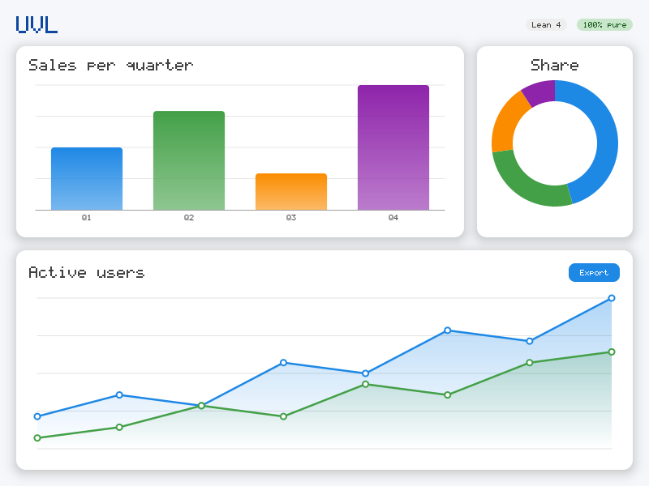
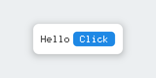
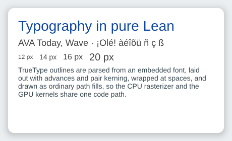
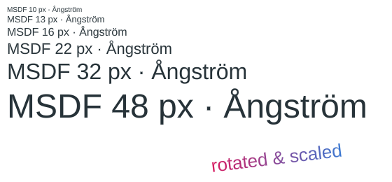
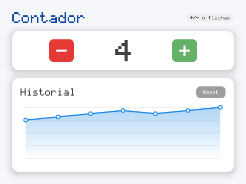
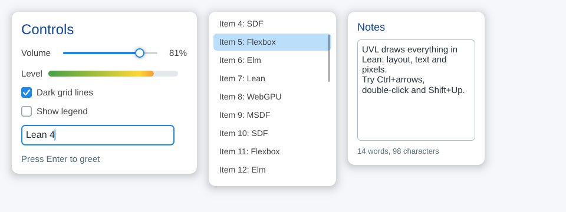
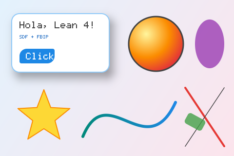

# UVL — universal visualization library

A visualization and UI library written **100% in Lean 4**: no DOM, no GTK/UIKit, no C
dependencies. Lean controls everything, from the widget tree down to the last pixel; the host
platform only has to provide a *framebuffer* and a stream of events.



## Status

| Milestone | Contents | Status |
| --- | --- | --- |
| 1. Core and image | Verified `FrameBuffer`, SDF-based 2D primitives, Bézier paths, gradients, shadows, text, CPU rasterizer, PNG/PPM | ✅ |
| 2. Layout and DSL | *Box constraints* layout engine with invariants in the types, flex (row/col/expanded), stack, `ui!` DSL, charts | ✅ (first version) |
| 3. Desktop interactivity | Elm-style runtime (`App`, `Event`), hit testing, hover/press, SDL3 runner | ✅ |
| 4. GPU and browser | Lean runtime + `Init` compiled to WebAssembly with Emscripten, WebGPU presenter with Canvas 2D fallback, DOM events | ✅ |
| 5. GPU rendering | Typed shader DSL in Lean that emits WGSL, render ops lowered to GPU primitives, SDFs/paths/text evaluated in the fragment shader, one pipeline per primitive kind; browser (WebGPU) and desktop (wgpu-native); output matches the CPU rasterizer | ✅ |
| 6. Fonts | TrueType parser in Lean, embedded UVL Sans, kerning and wrapping, `label`/`paragraph`; MSDF atlas generated in Lean, persistent on the GPU, identical sampling on CPU and GPU | ✅ |
| 7. Controls | Pointer capture, keyboard focus, wheel routing; slider, checkbox, text field, scroll view; incremental GPU uploads | ✅ |
| 8. Animation and editing | Runtime clock, blinking caret, hover fade-in, `Tween` with easing curves; text selection (drag, double-click, Shift, Ctrl+A), word navigation, the system clipboard on web and desktop; multi-line `textArea` | ✅ |
| Bare metal | Tiled rendering (RGB565 / 1-bit, identical to the full frame), C runtime without `libleanrt` tested on ARM Cortex-M3 (QEMU) and running on an ESP32 LilyGO T-Display; see [`baremetal/`](baremetal/README.md) | in progress |

## Quick start

```bash
lake build              # the library
lake exe uvl-demo       # writes out/primitives.png, out/hello.png, out/dashboard.png
lake test               # golden image, layout and codec tests
lake test -- --update   # regenerate the golden images
lake exe uvl-bench      # rasterizer time per frame
lake exe uvl-counter    # desktop app (needs SDL3; renders with wgpu-native)
lake exe uvl-controls   # slider, checkboxes, text field, scroll view
lake exe uvl-gpu-check  # GPU renderer vs CPU rasterizer, headless
web/build.sh            # browser app in web/dist (needs Emscripten)
```

Requires Lean `v4.35.0` (pinned in `lean-toolchain`).

### Function API

```lean
import UVL
open UVL UI

def hello : UI.Widget Unit :=
  center <| card <| col [ row [ text "Hello", button "Click" ] ]

def main : IO Unit :=
  Image.writePNG "hello.png" (UI.render hello 320 160)
```



### TrueType text

`label` and `paragraph` draw text with a TrueType font at any pixel size. UVL ships
**UVL Sans**, a Latin-1 subset of Liberation Sans (SIL Open Font License, see
[assets/fonts](assets/fonts)), embedded in the library. The parser reads `cmap`, `hmtx`,
`glyf` (simple and composite glyphs) and `kern` in pure Lean.

```lean
col [ label "Typography in pure Lean" (size := 28),
      paragraph "Wrapped at spaces to the given width…" 380 (size := 14) ]
```



Glyph outlines become ordinary path fills, so the CPU rasterizer, damage tracking, tiles
and the GPU kernels all draw them. `text` keeps the built-in bitmap font, which is what the
bare-metal targets use.

With `msdf := true` (or `Text.linesOpsMSDF`), glyphs are drawn from the font's **MSDF
atlas** ([Render/MSDF.lean](UVL/Render/MSDF.lean)) instead: each glyph is turned once, in
Lean, into a 32×32 grid of three signed distances (edge coloring at corners, pseudo-distances,
sign fixed by winding number), and drawing costs a bilinear lookup and a median per pixel at
any size, rotation or scale. Cells are generated on first use (about 2.5 ms per glyph), and on the CPU an MSDF line
draws faster than its outlines (540 characters at 14 px: about 15 ms vs 19 ms per 800×600 frame). On the
GPU the atlas is a buffer that persists across frames: each glyph's cell is uploaded once.



### The `ui!` DSL

Indentation-based syntax: each line is `widget args*`, and `:` opens a block of children (or
`;` on the same line). It is pure sugar over the function API: `name` resolves to
`UVL.UI.name`, so adding a new widget is just defining a function.

```lean
def dashboard : UI.Widget Unit := ui! pad 20:
  col (gap := 16) (align := .stretch):
    row (gap := 12):
      text "UVL" (size := 3)
      spacer
      chip "Lean 4"
    expanded:
      card:
        lineChart [[3, 5, 4, 8, 7, 11], [1, 2, 4, 3, 6, 5]]
```

### Interactive apps (Elm architecture)

An app is `init`, a pure `update : Msg → Model → Model` and a pure
`view : Model → Widget Msg`. The runtime (also pure) takes care of layout, hit testing,
hover/press feedback and deciding when a new frame is needed. See
[Examples/Counter.lean](Examples/Counter.lean):

```lean
inductive Msg | inc | dec | reset

def view (m : Model) : UI.Widget Msg := ui! pad 24:
  card:
    row (gap := 16) (justify := .center):
      button "-" (onTap := some Msg.dec)
      text (toString m.count) (size := 6)
      button "+" (onTap := some Msg.inc)

def app : App Model Msg where
  init := {}
  update
  view
  subscriptions                      -- keyboard, ticks, ...
    | .keyDown .up, _ => some .inc
    | _, _ => none
```



* **Desktop:** `UVL.SDL.run app` opens a window with SDL3 and draws it **on the GPU** with
  the same renderer and WGSL as the browser, through wgpu-native's `webgpu.h` (Vulkan, Metal or
  D3D12; [native/gpu_shell.c](native/gpu_shell.c)). Without a usable GPU, or with
  `UVL_RENDERER=cpu`, Lean rasterizes the frames (with partial redraw) and SDL presents them.
  The C shells ([native/sdl_shell.c](native/sdl_shell.c)) only translate events and move
  buffers; there is no UI logic in C. Frames are only redrawn when something changed, so an
  idle UI costs nothing.
* **Headless / tests:** `Runtime.simulate` feeds a script of events; the tests click around
  and compare the resulting frame with a golden image.

Building the desktop app needs SDL3 (`brew install sdl3`, or build it from the GitHub
releases); Lake finds it with `pkg-config sdl3` or in the usual prefixes. wgpu-native is
downloaded on first build (a pinned prebuilt release, see
[native/fetch_wgpu.sh](native/fetch_wgpu.sh)) unless `WGPU_NATIVE_DIR` points to one. Without
a display the app can be tested with
`SDL_VIDEO_DRIVER=offscreen UVL_MAX_FRAMES=2 UVL_CLICK_TARGET=1 UVL_SCREENSHOT=shot.png lake exe uvl-counter`
(CPU frames; under `xvfb-run` with `SDL_VIDEO_DRIVER=x11` it renders on the GPU and checks the
GPU frame against the CPU one). `lake exe uvl-gpu-check` renders the example scenes headless on
the GPU and compares them with the CPU rasterizer.

* **Browser:** `web/build.sh` compiles the same app to WebAssembly; see below.

### Stateful controls

`slider`, `checkbox`, `textField` and `scrollView` ([UI/Controls.lean](UVL/UI/Controls.lean))
keep their state in the model, Elm style: each is drawn from that state and dispatches a
message with the new state.

```lean
structure Model where
  volume : Float := 0.4
  name : TextInput := {}
  scroll : Nat := 0

col [ slider m.volume .volume,
      textField "name" m.name .name (placeholder := "Type your name…") (onSubmit := some .submit),
      scrollView m.scroll .scrolled (height := 280) (col rows) ]
```



The runtime captures the pointer while a slider is dragged (even off the track), gives the
keyboard to the focused field (click, Tab, Escape; editing keys, Home/End, Enter), and sends
the wheel to the scroll view under the pointer. Scroll views are the one node of the placed
tree whose child may be taller than itself: content is clipped and translated, and only the
visible part of it can be hit. Underneath are three new target actions (`drag`, `input`,
`scroll`) next to `tap`, so other controls are a few lines each. Tests drive all of it with
scripted events, and CI does it with real input in the browser and in an SDL window.

### Animation, selection and clipboard

The runtime keeps a clock from `tick` events and asks the shell for frames only while
something moves: an app animation (`App.animating`), the blinking caret of the focused field
(`Widget.blink`), or hover feedback fading in. App animations are ordinary model state:
a `Tween` ([UI/Tween.lean](UVL/UI/Tween.lean)) eases a number to a target with one of
the `Easing` curves (quadratic, cubic, back, elastic, …), and retargeting it mid-flight starts
from the value on screen. The level meter in the controls example follows the slider this way:

```lean
  | .volume v, m => { m with volume := v, meter := m.meter.to v }
  | .frame dt, m => { m with meter := m.meter.step dt }
  …
  subscriptions := fun e _ => match e with | .tick dt => some (.frame dt) | _ => none
  animating := fun m => !m.meter.done
```

Text fields select by dragging, Shift+click, Shift+arrows/Home/End and Ctrl+A (Cmd on macOS);
typing or pasting replaces the selection. Ctrl+Left/Right move by words, Ctrl+Backspace/Delete
delete one, and a double-click selects the word under the pointer.

`textArea` is the multi-line version ([UI/TextEdit.lean](UVL/UI/TextEdit.lean) holds the
editing logic both share): text wraps at the width and at Enter, Up/Down keep the horizontal
position, Home/End go to the ends of the visual line and Ctrl+Home/End to the ends of the
text, and the contents scroll to keep the cursor in view (or with the wheel).

Input methods (IME) work on both platforms: the text being composed (`Event.compose`) shows
underlined at the cursor until it is committed. In the browser, text input goes through a
hidden `<textarea>` placed over the focused field, which also brings up virtual keyboards on
touch devices; the desktop shell forwards SDL's text-editing events and points the candidate
window at the field (`Runtime.inputRect`).

**Accessibility.** Widgets describe themselves with `Semantics` (role, label, value, checked):
labels and paragraphs are text, controls declare their role, and any other tap target is a
button named after the text inside it. `Runtime.semantics` flattens the view into that tree
(scrolled-out content is left out), and the browser shell mirrors it as invisible ARIA elements
over the canvas, so screen readers can read the app and activate its buttons and checkboxes.

Both keep an undo history: Ctrl+Z undoes, Ctrl+Y or Ctrl+Shift+Z redoes, and a run of typed
(or deleted) characters is one step. Ctrl+C and Ctrl+X put the selection in
`Runtime.clipboard`, which shells hand to the system clipboard (the browser's copy event, or
`SDL_SetClipboardText`); pasted text arrives as one text-input event.

### Browser (WebAssembly + WebGPU)

```bash
source ~/emsdk/emsdk_env.sh     # Emscripten SDK
web/build.sh                    # → web/dist/{index.html,uvl.js,uvl.wasm,uvl-web.js}
python3 -m http.server -d web/dist
```

Lean only ships its runtime and core library as native code, so the first run builds them
for wasm32 and caches them in `.lake/build/wasm`: the runtime from the Lean sources of the
exact toolchain version, and `Init` from C generated by `lean -c`. The app itself is the C
that Lake already generates, linked with a small shell ([web/web_shell.c](web/web_shell.c)).
Symbols that only compile-time code references (elaborators, `bv_decide` proofs) get stubs.

[web/uvl-web.js](web/uvl-web.js) runs the `requestAnimationFrame` loop and packs DOM input into
the same event format as the SDL shell ([App/Host.lean](UVL/App/Host.lean)). Frames are drawn
by one of three backends (`?backend=` in the URL):

* `gpu` (default): the scene is **rendered on the GPU** (see below). Lean lowers it to
  primitives and generates the WGSL program; the JavaScript only uploads two buffers and
  issues one draw call.
* `webgpu`: Lean rasterizes on the CPU and WebGPU presents the damaged windows of the frame.
* `canvas2d`: the same CPU frames through `putImageData`, without WebGPU, also used when the
  GPU device is lost.

CI runs every backend in headless Chromium (WebGPU on Mesa's lavapipe): a real click must
change the frame, and what the GPU drew is read back and compared with the CPU rasterizer
(identical for the counter, at most 1/255 off on the dashboard).

The counter is a 2 MB `.wasm`. Any app works: export a constructor with
`@[export uvl_web_make] def make (w h : UInt32) : AnyRuntime := .start app w h` (see
[Examples/CounterWeb.lean](Examples/CounterWeb.lean)) and pass the module to `web/build.sh`.

### GPU rendering ([UVL/GPU](UVL/GPU))

* **A typed shader DSL** ([GPU/WGSL.lean](UVL/GPU/WGSL.lean)). WGSL expressions are values
  of `Expr t`, indexed by their WGSL type, so an ill-typed shader is a Lean type error. Programs
  are built in a small monad (`let_`, `var_`, `if_`, `for_`, `ret`), and `Fn.def1`…`Fn.def4`
  turn Lean functions over expressions into WGSL functions plus typed Lean functions that call
  them. Every program also has a meaning in Lean (`Stmt.run`).
* **Kernels in the DSL** ([GPU/Kernels.lean](UVL/GPU/Kernels.lean)): the signed distance
  functions of `Render/SDF.lean`, the scanline rule of the path filler evaluated per pixel,
  distance to flattened polylines for strokes, exact glyph-cell coverage for text, MSDF
  atlas sampling, gradients.
* **Lowering** ([GPU/Batch.lean](UVL/GPU/Batch.lean)): each render op becomes one primitive (a
  pixel rectangle drawn as two triangles, plus its parameters) or, for paths, one per 8-row
  band carrying only that band's edges. Each primitive covers exactly the pixels the CPU
  rasterizer would visit, and the GPU blends them in paint order. Every primitive kind has
  its own fragment entry point and pipeline; runs of the same kind share a draw call.
* **Checked without a GPU**: the tests evaluate the generated shader in Lean for every pixel
  ([GPU/Reference.lean](UVL/GPU/Reference.lean)) and get frames **bit-identical** to
  `Raster.render`, and the DSL's SDFs agree with `UVL.SDF`.

* **Incremental uploads**: the primitive and data buffers persist across frames, and only
  the float ranges that changed since the previous frame are written
  (`Batch.changedRanges`, in Lean, shared by the browser and desktop hosts). Pressing a
  counter button uploads a few hundred bytes; an inserted primitive (a hover highlight)
  rewrites the records after it.

The desktop uses the same program through wgpu-native; CI checks it headless
(`uvl-gpu-check`, at most 3/255 off, MSDF text included) and in an X11 window on Xvfb.

Per frame, the CPU only builds the view and the primitives: 0.07 ms for the counter and
0.33 ms for the dashboard natively (0.4 ms and 1.9 ms in WebAssembly), instead of 55 and 90 ms
of rasterization. The shading work itself has only been measured on lavapipe, a software
Vulkan implementation that runs on the CPU, so CI has no meaningful GPU timings.

### Performance

`lake exe uvl-bench` measures CPU time per full frame, one core, 800×600: about 55 ms for the
counter and 90 ms for the dashboard natively; WebAssembly in V8 is about 1.3× slower. Frames
are only rendered when something changed, and then only partially; in the browser the GPU
renderer replaces CPU rasterization altogether. What matters most on the CPU:

* **Partial redraw** ([Render/Damage.lean](UVL/Render/Damage.lean)): `Runtime.present`
  diffs the new scene against the last presented one (structurally, through groups,
  transforms and clips), repaints only the damaged windows and copies them into the previous
  frame, which is updated in place. Shells upload only those windows (`writeTexture` with an
  origin in WebGPU, dirty rectangles in Canvas 2D). The result is bit-identical to a full
  render (checked by the tests). Hovering a counter button repaints about 6 000 of 480 000
  pixels: **1.7 ms** instead of 56 ms.

* The rasterizer exploits that an SDF is 1-Lipschitz: one evaluation skips whole runs of
  pixels outside the shape or fills whole runs inside it, and only the anti-aliased edge is
  evaluated pixel by pixel.
* `Float` literals are elaborated to `Float.ofBits` with the bit pattern computed at compile
  time ([Core/FloatLit.lean](UVL/Core/FloatLit.lean)); Lean compiled them as
  `Float.ofScientific`, with arbitrary-precision arithmetic on every evaluation. For the
  same reason the library converts naturals with `Nat.toF` rather than `Nat.toFloat`, which
  rebuilds the big number `2 ^ 53` on every call.
* The scan loop is `@[specialize]`d per shape, so per-pixel distance evaluations are
  first-order code with unboxed floats rather than closure calls.

### Low-level scenes (`RenderOp`)

```lean
def scene : Array RenderOp := #[
  .shadow ⟨32, 40, 200, 120⟩ 16 10 (Color.black.withAlpha 0.35),
  RenderOp.roundRect ⟨24, 28, 200, 120⟩ 16 Color.white,
  .fill (.circle ⟨320, 90⟩ 56) (.radial ⟨300, 70⟩ 80 #[(0, Color.yellow), (1, Color.red)]),
  RenderOp.path (Path.star ⟨90, 240⟩ 56 24 5) Color.yellow ]

#eval Image.writePNG "scene.png" (Raster.render 480 320 scene)
```



## Architecture

```
UVL/
  Core/       Color, Vec2/Rect/Affine, fast Float literals, pixel formats
  Render/     FrameBuffer (verified), SDF, Paint, Path, Font, RenderOp, Raster, Tile, Damage
  Text/       TrueType parser, embedded UVL Sans, shaping, wrapping
  GPU/        typed WGSL DSL, shader kernels, lowering to GPU primitives, reference renderer
  Output/     Deflate/zlib and PNG/PPM in pure Lean
  Layout/     Constraints, Placed (positioned tree), Widget + layout engine
  UI/         widget API, ui! DSL, charts (bar, line, donut), TrueType labels
  App/        Event, App and Runtime (Elm architecture, hit testing), Host (C ABI for shells)
  BareMetal/  app shell for microcontrollers (see baremetal/)
UVLWindow.lean  SDL3 shell (FFI), only used by the uvl-* window executables
UVLGPU.lean   desktop GPU renderer bindings (wgpu-native)
native/       sdl_shell.c, gpu_shell.c, fetch_wgpu.sh
web/          browser shell (C + JS), build script, headless browser smoke test
baremetal/    C runtime and tooling for running UVL apps without libleanrt
Examples/     example scenes and apps, demo executable
Tests/        golden images, test PNG decoder, test driver
```

### What the types guarantee

* **No write outside the buffer.** `FrameBuffer w h` carries the proof
  `data.size = w * h * 4`; pixels are addressed with `Fin w × Fin h` and `pixel_index_lt`
  proves that every byte offset is in range. The rasterizer loops walk a `Clip w h` with
  proven bounds, so there are no bounds checks on the hot path.
* **In-place mutation.** The `FrameBuffer` is threaded from function to function with a
  unique reference, and Lean's runtime (Perceus/FBIP) mutates the `ByteArray` without copies.
* **A widget's size always respects its parent's constraints.**
  `layout w c : Result c` includes `ok : c.Admits size`
  (`minW ≤ w ≤ maxW ∧ minH ≤ h ≤ maxH`). See `Constraints.constrain_admits`.
* **No child overflows its parent.** The positioned tree `Placed s` is indexed by its size
  and every child carries the proof `x + child.w ≤ s.w ∧ y + child.h ≤ s.h`; a tree with
  overflow simply does not type-check.
* **Layout always terminates.** `layout` is a total function (well-founded recursion over
  the widget tree), not `partial`.

### Rasterizer

* Analytic shapes (rectangles, rectangles with per-corner radii, circles, ellipses, segments,
  Gaussian shadows) from their SDF: one distance evaluation per pixel and anti-aliasing for
  free.
* Paths (lines, quadratic and cubic Béziers) flattened and filled by scanline with the
  *non-zero* or *even-odd* rule, exact horizontal coverage and 4 vertical subsamples.
* Strokes with round joins and caps; nested affine transforms and clipping.
* Text with a built-in 5×7 bitmap font (ASCII plus accented letters), rasterized with exact
  area coverage at any scale, and TrueType text (see above).

## Next steps

1. Accessibility on desktop (platform accessibility APIs) and keyboard operation of sliders.
2. Close the gap between MSDF and exact outlines at UI sizes (today 7–11% of the ink at
   11–16 px, measured in `Tests/Text.lean`), then make MSDF the default for UI text; until
   then outlines stay the default (exact, and no atlas memory on small devices).
